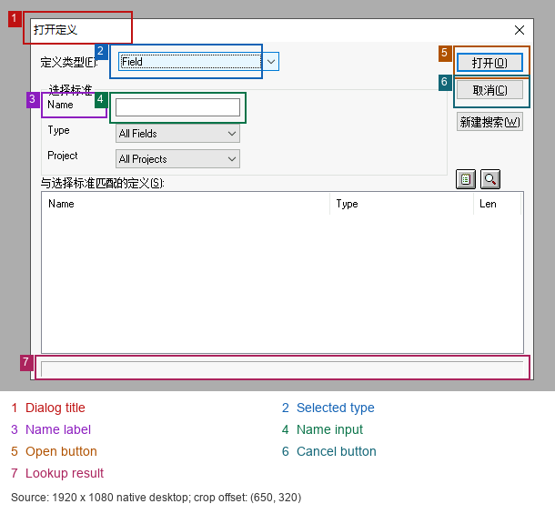

# 截图与 OCR 场景约定

业务步骤由 MaaFramework 读取 Pipeline JSON 执行。截图、OCR、模板匹配、等待和分支都使用框架已有能力，运行时不需要 AI 判断。以下坐标来自当前开发基准，不能据此声称创建 Field、Record、AE 的完整 MCP 流程已实测通过。

## 两套截图坐标

| 截图 | 有效范围 | 使用场景 |
| --- | --- | --- |
| RDP 原始画布 | `1920×1080`；底层 `1920×1088` 的末尾 8 行裁掉 | HRDEV/PSIDE 的对象创建、输入和保存 |
| 浏览器视口 | 当前实测 `1920×897`；恢复控制器只在底部补白到 `1920×1080`，不缩放 | JumpServer 的空闲超时、资产连接页、浏览器工具面板 |

两者左上角不同。RDP 内的 `(780,378)` 不能直接当作浏览器坐标点击；控制器负责按实际画布位置和缩放换算。断开后即使 RDP canvas 消失，Playwright 仍能截取浏览器页面，再由 Maa 识别中央提示框。浏览器高度、面板布局变化后，应重新定位提示框，不能把旧的绝对 ROI 当成通用值。

完整截图用于还原上下文和检查分辨率。识别只在对应 ROI 内进行；按钮图标、单选框和保存状态优先使用模板匹配。局部截图保留原始像素，文档示意图上的编号不参与识别。

## PSIDE 的具体场景

ROI 格式是 `[x,y,width,height]`，以下为远程桌面坐标。标为“离线校准”的区域已在同一张真实截图上用 Maa 原生 OCR 复测；其他数值是现有 JSON 的范围，仍须结合各状态截图验证。

| 场景/节点 | 看什么 | 当前范围与收窄方式 | 检查和后续动作 |
| --- | --- | --- | --- |
| 进入任务：`PSIDE_CreateField` 等 | HRDEV、空白主窗口标题、工具栏可用状态 | 标题 `[0,0,1100,70]`，工具栏模板 `[5,40,52,32]` | 两项均匹配才允许打开定义；标题本身不能证明没有模态框 |
| 打开定义标题 | “打开定义” | 旧范围 `[650,300,600,100]`；离线校准 `[675,332,120,36]` | 标题命中才识别框内类型和名称 |
| 类型标签/类型值 | “定义类型”、Field/Record/App Engine Program | 标签 `[690,370,90,40]`；Field 类型值离线校准 `[770,368,168,38]`，排除右侧箭头 | 选择后必须再次核对值；不能仅凭按键发出就判成功 |
| 类型下拉菜单 | 目标对象类型 | 现有菜单范围 `[775,390,190,330]`；已知目标行时可继续收窄 | 仅菜单展开后识别；选中后核对折叠框，避免点击 OCR 框侵入相邻行 |
| 名称输入 | Name 标签、传入的完整名称 | 标签 `[695,420,100,25]`，输入值 `[775,425,140,25]`；标签离线校准 `[695,421,72,28]` | 输入后核对名称再打开；最大长度名称的边距还需验证 |
| 查重结果 | 明确的 0 条结果或已打开对象标题 | 结果栏 `[690,710,540,25]`，已打开标题 `[0,0,1100,70]` | 空白列表不等于 0 条；已存在则结束并返回冲突 |
| 打开/取消/插入按钮 | 对应按钮文字 | 打开/插入 `[1150,370,80,40]`；取消 `[1150,400,80,40]` | 命中后点击文字框内部，并等待下一状态。离线校准打开/取消区域分别为 `[1148,370,84,36]` / `[1148,402,84,36]` |
| Field 类型和长度 | Field Type、Field Length 及右侧值 | 当前先在 `[430,75,1100,730]` 找标签；值已用 `roi: F_TypeFocus/F_LengthFocus` + `roi_offset` 引用 | 先定位标签，再检查右侧一行；后续将标签首次搜索限制到编辑器上部 |
| Field 标签表格 | Label ID / Long Name / Short Name 的表头和目标数据行 | 当前仍搜编辑器大范围；目标是表头锚点下的单行约 `540×30`，各列再细分 | 名称列和值分别定位；Label ID 必填。窗口级联移动时跟随锚点，不套固定全屏坐标 |
| Record 插入字段 | Insert Field 标题、字段名称 | 标题 `[680,335,560,45]`，名称与插入按钮同查重对话框 | 插入后核对列表目标字段；不是只核对搜索输入框 |
| Record 字段列表 | 字段名称列 | 当前 `[430,75,1100,730]` 待收窄；目标是列表名称列可见区，逐行或分页检查 | 重开后确认所有请求字段；不能只找到其中一个名字就结束 |
| Record 类型 | Record Type 标签、Derived/Work 或 SQL Table、选中圆点 | 先定位类型标签/选项，选中状态使用 `radio_selected.png` 的相对 ROI | 文字命中和选中状态都通过；SQL Table 定义保存不等于运行 SQL Build |
| AE Section / Step | MAIN、目标 Step01…Step04 | 当前 Step 首次定位范围 `[430,75,1100,730]` 待收窄；每个 Step 的后续检查引用它的识别框 | 找到指定 Step 后才处理对应 Action，不能在其他 Step 上输入 |
| AE Action 类型 | 当前 Step 的 SQL 或 PeopleCode | 引用 `A0_SelectStep` 等锚点，加 `[65,50,320,45]` 偏移；下拉菜单使用独立偏移范围 | 选择后核对 Action 类型；只支持 SQL/PeopleCode |
| AE 代码编辑器入口 | 代码类型、对象名、Step 名 | View 菜单 `[75,44,230,46]`，编辑器标题带 `[0,0,1100,70]` | 三项身份和活动窗口检查通过才粘贴代码 |
| 第一次命名保存 | Save As、名称、OK | 当前 Save As `[800,440,330,160]`；名称 `[840,520,160,30]`；OK `[1000,500,100,45]` | 输入后核对名称再确认；后续还要核对已命名标题并关闭重开 |
| SQL/PeopleCode 保存 | 保存图标从可用变为不可用；编辑器仍活动 | 图标模板 `[50,40,32,32]`；活动编辑器模板 `[430,75,1100,300]`；PeopleCode 另读 `[1100,1018,650,25]` 的 Last updated by | 待保存 → Ctrl+S → 已保存，并保持正确编辑器；代码正文不做 OCR，也不执行 AE |
| 错误提示/未知状态 | 当前模态框、错误标题和消息 | 使用当前对话框范围识别；未知错误没有通用成功分支 | 保存图标变灰但父窗口被错误模态框禁用，不能认定保存成功；保留截图并停止 |

图中的 1–7 是打开定义场景的局部区域，见表中的标题、类型值、名称标签、名称值、打开、取消、结果栏。它们使用原始桌面坐标，不是该裁剪图左上角的坐标。

## JumpServer 的场景

以下是**浏览器截图坐标**。这些范围来自既有恢复 JSON，在当前隐藏浏览器状态下的完整恢复尚未复测通过，不能当成已经稳定的定位结果。

| 场景 | 现有 ROI | 识别与通过条件 |
| --- | --- | --- |
| 120 分钟断开提示 | `[745,285,430,335]`；确定按钮 `[1090,370,80,235]` | 同时出现“连接异常”和完整的 120 分钟断开文案；标题、正文、按钮应在定位提示框后进一步分开识别 |
| 资产连接页 | 标题 `[550,80,850,200]`，表单 `[550,80,850,650]`，连接按钮 `[550,500,850,320]` | 资产名、RDP、Web GUI 等匹配才进入连接；连接按钮点击后还需独立确认原始画布尺寸及 HRDEV |

浏览器工具面板或透明遮罩会影响鼠标投递；原始 canvas 截图不会包含这些网页层。因此排查“文字能识别、点击无效果”时，同时保留浏览器截图和原始桌面截图。不能绕过遮挡检查就把点击当成功。

## ROI 校准和证据规则

先根据已知场景在预期区域定位标题或表头，再通过 Maa 原生的 `roi` 节点引用和 `roi_offset` 定位具体输入框、值和按钮。只在定位锚点时搜索较大范围，后续不反复 OCR 整个编辑器。锚点未找到或窗口不在预期范围时停止，不能把“找不到”转换成点击旧坐标。

保留文字周围数个像素的余量，避免切掉字符、包含相邻行或下拉箭头。固定单行文本框可试 Maa 的 `only_rec: true`；有多个控件的面板继续使用文字检测。对同一截图比较 ROI 后，再用新截图和真实操作复测，不靠放宽名称或类型正则掩盖误识别。

2026-11-04 的离线对比，输入均为 `1920×1080` 同一截图，模型为现有 Maa OCR：

| 方案 | ROI | 结果 |
| --- | --- | --- |
| 旧类型框 | `[775,375,190,25]` | `Freld`，未命中 Field |
| 有上下边距且排除箭头 | `[770,368,168,38]` | `Field`，命中，模型分数约 0.881 |
| 固定框内单行 + only_rec | `[780,378,155,20]` | `Field`，命中，模型分数约 0.944 |

分数是模型对此次识别的评分，不是整体正确率。原始截图及对比结果保存在本机忽略目录 `psauto/out/objects/20261104_101348_005176/`、`psauto/out/roi_calibration.json`。随后在当前 HRDEV 会话只运行 `PSIDE_CreateField_query_type_check`，覆盖 `next: []`，实际返回 `hit=True, completed=True`；证据位于 `psauto/out/runs/20261104_102504_174537/`。这次只读检查没有创建或保存对象。

完整运行的证据应能对应：场景/节点名、ROI 或锚点、预期文字或模板、识别框和结果、动作与点击点、等待时间、动作后的检查、失败节点。现有 `report.json`、`events.json` 和原生截图已提供执行记录；后续局部图由同一原图裁剪用于复核，不能另截一张不同状态的图充当该节点证据。
