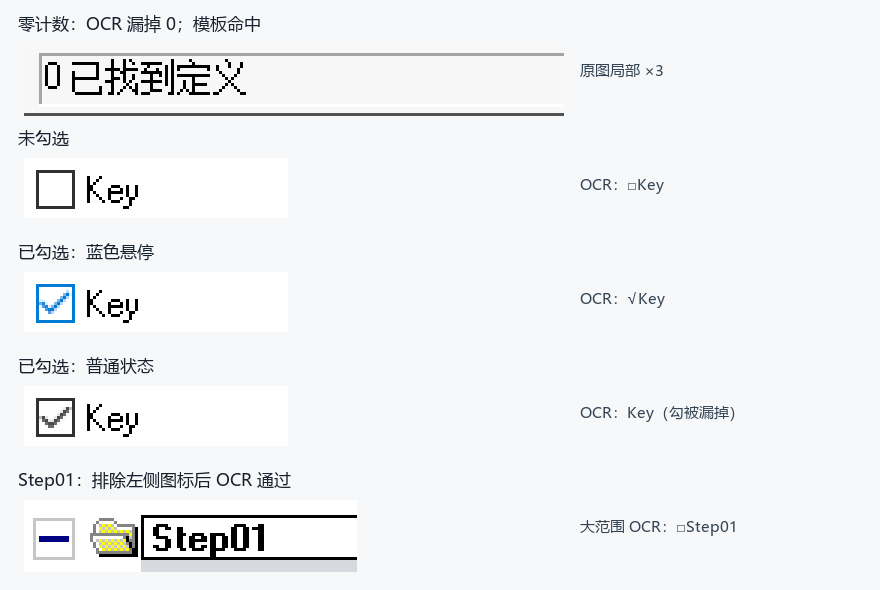

# OCR 与模板匹配的真实截图对比

2026-11-04，使用现有 PSIDE 原始桌面截图和 MaaFramework 原生 `OCR`、`TemplateMatch` 离线对比。没有连接或操作浏览器，没有 AI 参与识别决策。

OCR 也是从截图读取像素，输出文字和文字框；不是读取网页 DOM 或控件文本。模板匹配使用一张小截图，在指定区域寻找相似的像素图案。文字也可以作为模板图案，但模板不会理解或读取其文字内容。

## 结果

| 目标与样本 | OCR 实际结果 | 模板实际结果 | 对工程的含义 |
| --- | --- | --- | --- |
| “0 已找到定义”，两次真实截图 | 两次均漏掉 `0`，收窄 ROI / only_rec 后仍漏 | 两次命中；数字改成 1、10 的合成反例均被拒绝 | 零结果反馈用包含数字的完整局部模板，不能只认“已找到定义” |
| Key 复选框：未勾、已勾蓝色悬停、已勾普通态 | 分别读出 `□Key`、`√Key`、`Key`；普通勾选态漏掉勾 | 普通勾选模板只认普通态；增加蓝色模板后两种勾选态通过，未勾态被拒绝 | 文字定位标签，图像判断状态；模板需要覆盖正常、悬停、禁用等必要状态 |
| SQL Table，两次不同窗口位置 | 都读成 `SQLTable`，严格含空格正则失败 | 同一小模板在移动后的目标 ROI 内仍命中 | 这是空格差异，不是错误地读成其他类型；允许可选空格的 OCR 也可解决。当前流程按分组锚点定位、圆点模板判定 |
| Step01，插入 Action 后的真实帧 | 大 ROI 读成 `□Step01`，严格正则失败；裁掉左侧图标后读成 `Step01`，通过 | 由插入前截图取的小模板在插入后帧命中；目标不存在时不命中 | 避免把树形展开图标、文件夹图标与名称合并识别 |
| “取消”按钮，两张有按钮、一张无按钮截图 | 两张命中、无按钮不命中 | 两张命中、无按钮不命中 | 两者均可；固定按钮优先模板，仍需下一状态确认 |
| 两个变化的对象名，三张真实帧 | 正确读出两次 `GM_MCP_EMPLID`、一次 `GM_MCP_AE` | 未为每个业务名称制作模板 | 参数化名称保留局部 OCR；不随入参增加图片资源 |
| Step01 图像合成放大到 125% | 对应缩放 ROI 内仍读对 | 原尺寸模板不命中 | 模板对缩放敏感；这只是合成探针，不能代替真实 DPI 环境测试 |

## 耗时与边界

每个用例先预热一次，再重复三次，计 `post_recognition(...).wait()` 的中位数；不含模型加载、Playwright CLI、远程截图、鼠标和等待页面变化的耗时。

- 小 ROI 模板约 **18–23 ms**；小 ROI OCR 约 **39–80 ms**。
- 同一 Step01，大 ROI OCR 约 **1186 ms**，局部单行 OCR 约 **39 ms**，局部模板约 **20 ms**。搜索大区域的缺失目标模板约 **272 ms**，所以模板也应限制 ROI。
- 这些数字仅代表本机这组截图。三次重复不算三个独立样本；模型分数和模板相似度也不是正确率，不能互相比较。
- 新 SQL / Step 模板分别取自第一张图或操作前帧，使用另一帧检查；复选框悬停模板取自本组悬停图，只证明已覆盖这个样式，尚无独立悬停测试集。截图来自同一会话和主题，不能宣称跨主题、跨 DPI 或长期稳定。
- 完整本地实验脚本、源图路径、每项 ROI、模板、结果和计时保存在 Git 忽略目录 `psauto/out/compare_recognition.py`、`psauto/out/recognition_comparison/results.json`。合成反例与合成缩放有明确标记，不冒充真实界面截图。

## 应用规则

固定图标、按钮、单选与复选状态、保存图标，以及固定的零结果提示优先使用局部模板。动态对象名、字段名、Step 名及错误消息使用局部 OCR；先找场景锚点，再识别目标内容。两者都只负责某个明确检查，成功与否由 Pipeline 的下一状态验证，不凭“鼠标接口返回成功”决定。

原 MR3A 游戏流程本身也混合使用两者。例如 `assets/resource/pipeline/领取饭团.json` 的主页面检查使用模板，“好友页面”使用 OCR。保留这套通用组件，按目标特征选识别方式，无需另造识别引擎。SQL / PeopleCode 正文继续只做剪贴板输入、保存反馈检查，内容验收交给 dbx。
