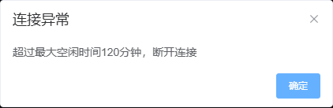
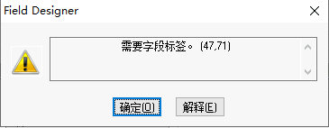
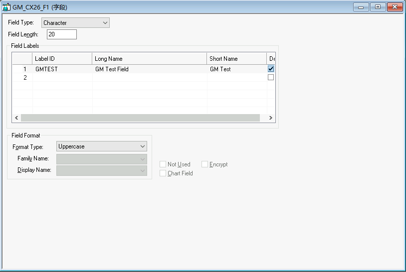
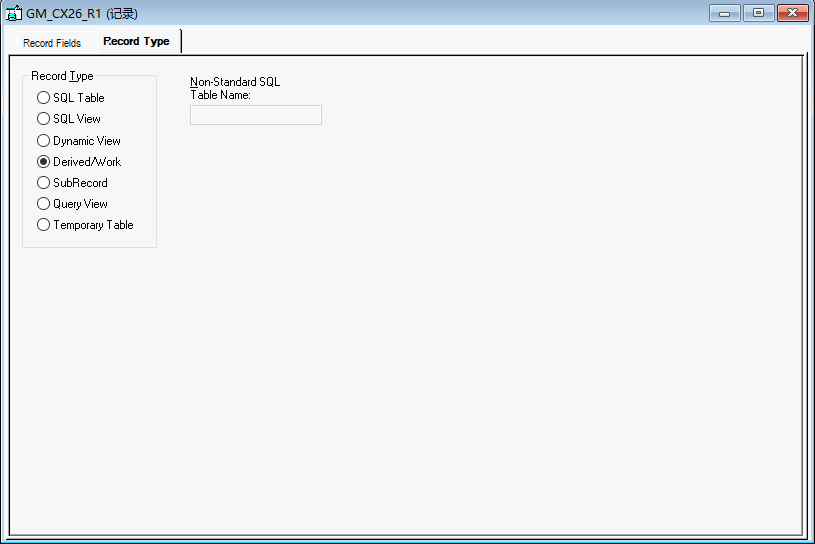

# JumpServer 空闲超时恢复

运行时由 Python 调用 Maa 原生 Pipeline，通过 Playwright CLI 操作已授权的 Chrome；没有模型调用、AI 看图或自然语言动作推理。浏览器控制器只提供截图、点击和刷新通道，识别和步骤选择都在 [recovery.json](../../assets/resource/pipeline/PSIDE/recovery.json) 中。



从 `psauto/` 执行：

```powershell
..\.psauto-runtime\venv\Scripts\python.exe recover_session.py --recover
```

`run_pipeline.py` 在执行业务 Pipeline **之前**连接失败时，也会调用这条恢复路径。`--no-recovery` 可关闭。业务 Pipeline 一旦开始执行，失败后直接停止，不自动重放任务。尤其是保存动作超时时，不能因重连成功就认定原保存失败。

| 阶段 | 识别及检查 | 动作、等待和下一步 | 失败行为 |
|---|---|---|---|
| 通道检查 | 浏览器必须在配置的 JumpServer origin，宽 1920，高 720–1080 | 原像素截图，底部补白到 1920×1080；不缩放 | 不符合即停止 |
| 超时识别 | 中央 ROI `[745,285,430,335]` 同时 OCR 命中“连接异常”和“超过最大空闲时间120分钟…断开连接” | 进入确认节点；识别超时 3 秒 | 不命中不点击 |
| 确认提示 | 右侧 ROI `[1090,370,80,235]` OCR 精确命中“确定” | 点击识别框，等待 1500ms，进入刷新节点 | 失败停止 |
| 刷新会话 | 只由已确认的超时路径进入，或显式运行模拟重连命令 | Maa `StartApp` 映射到 Playwright CLI `reload`；仅确认 `beforeunload`，等待 3000ms | 其他原生弹窗停止；CLI 超时禁用会话 |
| 连接页 | OCR 同时检查“连接…PS开发测试”、RDP、用户名、Web GUI、记住密码 | 进入连接按钮节点；最多等待 15 秒 | 未知登录页、MFA 或其他资产不执行连接动作 |
| 连接按钮 | ROI `[550,500,850,320]` OCR 命中“连接…当前在线” | 点击识别框，等待 5000ms | 不按固定坐标盲点 |
| 恢复确认 | 最多 45 秒等待原生 RDP canvas；核对有效尺寸 1920×1080；Maa OCR 检查 HRDEV 标题 | 所有检查通过才报告连接恢复 | 按钮成功但画布/标题未恢复，整体仍失败 |

截图后视口变化时拒绝点击。每次调用最多执行一条恢复路径，没有无限刷新。流程复用浏览器已经保存的资产账号，不读取或保存密码；未保存凭据时，连接可能失败，并由最终画布检查返回失败。这尚未覆盖从 JumpServer 自身登录页重新输入账号或完成 MFA。

## 验证记录

- 2026-11-03：真实出现 120 分钟超时提示，Maa OCR 成功识别完整错误文案，并经原生 OCR 点击节点关闭提示。
- 关闭提示后只有黑屏，因此补充刷新、资产连接和最终状态核验。
- 2026-11-03 17:16：`recover_session.py --simulate-reconnect` 在 HRDEV 完成真实刷新退出→处理离开确认→OCR 识别连接页→连接→原生画布及 HRDEV OCR 检查，退出码 0。此测试没有等待 120 分钟，不等同于已经验证长期空闲后的完整自动恢复。
- 重连后实际出现桌面 canvas 与一个 64×64 的小平移图层。截图通道合成这两层后裁掉底部 8 行分配填充；未知图层数量、变换或尺寸仍失败。合成和异常图层拒绝有本地浏览器测试。
- 本地回归覆盖真实 Maa OCR + CLI 点击、未知错误不点击、视口变化拒绝点击、origin 不符拒绝点击、离开确认框及连接页识别；测试使用临时浏览器，不操作 HRDEV。

复现真实退出重连测试：

```powershell
..\.psauto-runtime\venv\Scripts\python.exe recover_session.py --simulate-reconnect
```

该命令先检查 HRDEV，再刷新当前连接，然后运行连接与核验流程。

## 运行证据

完整截图、Maa 原生 OCR 结果、识别框、动作点击点和成功/失败结果写入忽略的 `out/recovery/<时间>/`；`report.json` 对应执行节点，`events.json` 记录 Maa 通知，包括失败的识别候选，`recognition_*.png` 对应识别时画面。`before_disconnect/` 和 `remote_check/` 保存测试前后证据。普通业务运行同样写入 `out/runs/<时间>/`，参数覆盖另存 `override.json`。

运行截图可能包含账号或业务信息，因此完整报告只保留在本机。本页图片是裁剪后的超时提示与测试对象，不包含浏览器账号字段。

## 当前 GM 对象进度

`GM_CX26_F1` Field 已保存并关闭后重新打开核对：Character、长度 20、Label ID `GMTEST`、Long Name `GM Test Field`、Short Name `GM Test`。实际验证中发现长度框 `Ctrl+A` 未选中原值，使用 `Home` + `Shift+End` 后输入才正确；保存时字段标签必填。





`GM_CX26_R1` Record 已保存；包含上述 Field，类型为 Derived/Work。中断前最后一次保存命令实际已执行，重连后通过名称标题和类型画面确认。AE 尚未创建。这些 Field/Record 的填写过程仍属于开发取证，不能作为完整创建 Pipeline 已工程化的证明；目前已固化的是草稿入口与上述会话恢复路径。


